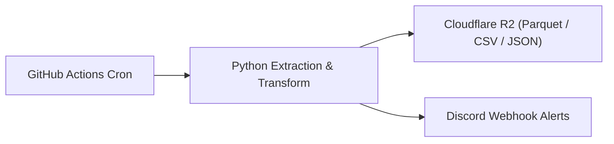

# Python Automation

Centralized automated data collection and processing suite covering gaming telemetry, entertainment media tracking, and financial analytics. Pipelines execute on automated schedules via GitHub Actions, store versioned datasets in Cloudflare R2 object storage, and report status notifications to Discord.



---

## Architecture & Structure

The repository is organized by domain into three primary directories:

```
Python-Automation/
├── Games/
│   ├── Black Desert Online/  # Central market prices, pearl items, and patch notes
│   ├── Guild Wars 2/        # Legendary armory, characters, PvP stats, wallet
│   ├── MapleStory/          # Character ranking snapshots and progression logs
│   └── Steam/               # Playtime activity and genre cache tracking
├── Entertainment/
│   ├── AniList/             # Reading progress and completed/planned logs
│   ├── MangaUpdates/        # Series warehouse facts, dimensions, and cover cache
│   └── Spotify/             # Recent listening history, track, and album analytics
├── Finance/
│   ├── Currency/            # USD-base foreign exchange rates
│   └── Salary/              # Role/location compensation benchmarks and FX conversion
├── .github/workflows/       # 23 isolated GitHub Actions workflow definitions
├── AGENTS.md                # Repository secret management protocol
└── LICENSE                  # GNU Affero General Public License v3.0
```

---

## Pipelines & Modules

### 1. Games

#### Guild Wars 2 (`Games/Guild Wars 2`)
Automates account-level data exports using ArenaNet API v2 tokens.
- **Armory (`gw2_armory.py`)**: Catalogs legendary equipment and shared inventory unlocks.
- **Character Details (`gw2_char_details.py`)**: Exports active character attributes, crafting disciplines, and gear.
- **PvP & Leagues (`gw2_pvp_stats_export.py`, `gw2_spvp_export.py`, `gw2_league_history.py`, `gw2_pvp_rank_summary.py`)**: Exports match logs, seasonal league standings, and profession performance metrics.
- **Wallet (`gw2_wallet.py`)**: Records account currency balances.

#### Black Desert Online (`Games/Black Desert Online`)
Monitors Central Market listings and Pearl Shop updates.
- **Market Items (`all_items.py`)**: Star-schema extraction of non-pearl market items across NA, EU, SA, and KR regions.
- **Pearl Items (`pearl_items.py`)**: Extracts Pearl Shop marketplace listings, categories, and inventory metrics.
- **Patch Notes (`patch-notes-pearls.py`, `patch-notes-pearls-v2.py`)**: Scrapes and normalizes official Pearl Shop notice updates and discount listings.

#### MapleStory (`Games/MapleStory`)
- **Character Telemetry (`maplechardata.py`)**: Queries MapleStory ranking APIs across multiple segmented character groups to compute daily, weekly, and monthly level/EXP deltas.

#### Steam (`Games/Steam`)
- **Player Activity (`steam_activity_github.py`)**: Connects to Valve's Steam Web API (`GetRecentlyPlayedGames`) to record 2-week rolling playtime and maps application metadata against Steam storefront genres.

---

### 2. Entertainment

#### AniList (`Entertainment/AniList`)
- **Reading Logs (`anilist_read.py`)**: Ingests user anime and manga progress milestones.
- **Media Archives (`anilist_done-planned_log.py`)**: Tracks completed and planned media catalog changes.

#### MangaUpdates (`Entertainment/MangaUpdates`)
- **Data Warehouse (`mangaupdate_warehouse.py`)**: Builds star-schema dimension tables (`DIM_Series`) and progress facts (`FACT_Progress`) in CSV and Apache Parquet formats.
- **Cover Image Cache (`mangaupdate_cover_cache.py`)**: Downloads, optimizes, and synchronizes series cover illustrations directly to Cloudflare R2 with circuit breaker controls.

#### Spotify (`Entertainment/Spotify`)
- **Streaming Telemetry (`spotify_fetch.py`)**: Connects via OAuth refresh tokens to pull recently played tracks and updates columnar Parquet stores for listening history, songs, albums, and artists.

---

### 3. Finance

#### Currency Rates (`Finance/Currency`)
- **Exchange Rates (`currency_rates.py`)**: Fetches monthly foreign exchange conversions against USD for multi-currency normalization using ExchangeRate-API.

#### Salary Analytics (`Finance/Salary`)
- **Salary Data Extraction (`rapidapi.py`)**: Pulls job salary distributions across roles and geographic locations via RapidAPI endpoints.
- **Salary Optimization (`salary_optimize.py`, `salary_transform.py`)**: Joins raw compensation numbers with latest currency exchange tables to compute normalized hourly, weekly, monthly, and annual compensation metrics.

---

## Automated Workflows

All scheduled tasks run inside `.github/workflows/` with isolated dependencies, scoped pip caching, and independent concurrency controls:

| Workflow File | Target Application | Schedule (UTC) |
| :--- | :--- | :--- |
| `gw2-armory.yml` | Guild Wars 2 | Daily at 18:30 |
| `gw2-char-details.yml` | Guild Wars 2 | Daily at 15:00 |
| `gw2-league-history.yml` | Guild Wars 2 | Daily at 22:00 |
| `gw2-pvp-rank-summary.yml` | Guild Wars 2 | Daily at 11:30 |
| `gw2-pvp-stats-export.yml` | Guild Wars 2 | Daily at 08:00 |
| `gw2-spvp-export.yml` | Guild Wars 2 | Daily at 04:30 |
| `gw2-wallet.yml` | Guild Wars 2 | Daily at 01:00 |
| `bdo-all-items.yml` | Black Desert Online | Every 4 hours |
| `bdo-pearl-items.yml` | Black Desert Online | Every 3 hours |
| `bdo-patch-notes-pearls.yml` | Black Desert Online | Daily at 01:00 and 13:00 |
| `maplechardata-fetch-01.yml` | MapleStory Group 1 | Daily at 07:00 and 18:00 |
| `maplechardata-fetch-02.yml` | MapleStory Group 2 | Daily at 07:00 and 18:00 |
| `maplechardata-fetch-03.yml` | MapleStory Group 3 | Daily at 07:00 and 18:00 |
| `maplechardata-fetch-04.yml` | MapleStory Group 4 | Daily at 07:00 and 18:00 |
| `maplechardata-fetch-05.yml` | MapleStory Group 5 | Daily at 07:00 and 18:00 |
| `steam-fetch.yml` | Steam Activity | Every 2 hours |
| `anilist-read.yml` | AniList Reading | 02:00, 08:00, 12:00, 16:00, 20:00 |
| `anilist-done-planned.yml` | AniList Archive | Daily at 14:00 |
| `mangaupdate-fetch.yml` | MangaUpdates Data | 8 runs daily |
| `mangaupdate-cover.yml` | MangaUpdates Covers | 09:00, 21:00 |
| `spotify-fetch.yml` | Spotify Streaming | Alternating 90-102 min schedule |
| `salary-fetch.yml` | Finance Salary | Monthly on the 27th at 12:00 |
| `currency-fetch.yml` | Finance Currency | Monthly on the 1st at 06:00 |

---

## Local Development

Each module is self-contained with its own dependencies and configuration:

```bash
# Example: Running Guild Wars 2 armory export locally
cd "Games/Guild Wars 2"
pip install -r requirements.txt
python gw2_armory.py

# Example: Running Finance Currency rates locally
cd "Finance/Currency"
pip install -r requirements.txt
python currency_rates.py
```

Create a `.env` file within the respective module directory to supply local credentials. Local environment files are excluded by `.gitignore`.

---

## License

This project is licensed under the terms of the GNU Affero General Public License v3.0 (`AGPL-3.0`). See the [LICENSE](LICENSE) file for complete terms.
